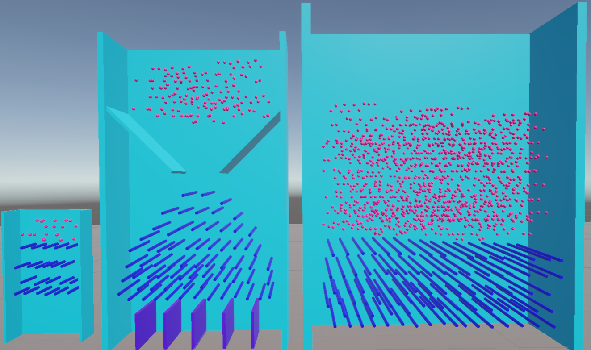

# Custom Physics Engine - Collision Detection & Response for Unity

## Table of Contents
- [About The Project](#about-the-project)
- [Features](#features)
- [Built With](#built-with)
- [How It Works](#how-it-works)
- [Controls](#controls)
- [Getting Started](#getting-started)
- [Known Limitations](#known-limitations)
- [Documentation](#documentation)

## About The Project

This is a collision detection and response engine built entirely from scratch in Unity (C#), **without using Unity's built-in physics**. 
It was developed as a school project during third year (in a week, alone).

The engine is showcased in a **Plinko-style demo scene**: balls fall through rows of pegs, bouncing and spinning realistically, 
while the player can drop extra capsules or spheres at runtime. The scene exercises the whole engine: the broad phase filters ball/peg and ball/ball pairs, 
GJK and EPA provide contact information, and the response handles bounces and rotation.



The pipeline that runs on every `FixedUpdate`:

```
Broad phase       ->  Narrow phase  ->  EPA               ->  Response               ->  Integration
(candidate pairs)     (GJK)             (normal, depth)       (impulses, rotation)       (semi-implicit Euler)
```

## Features

### Core Engine
- **Dynamic AABB Tree broad phase** - Fattened bounding boxes with lazy reinsertion
- **GJK narrow phase** - Fast intersection test using support functions
- **EPA contact generation** - Contact normal, penetration depth and contact point
- **Impulse-based response** - Restitution, linear and angular velocity
- **Position correction** - Prevents objects from sinking into each other
- **Static and dynamic bodies** - A mass of 0 marks an object as static

### Advanced Features
- **Rotation and inertia tensors** - Balls and capsules spin after impacts
- **Multiple collider shapes** - Sphere, capsule, cube and mesh
- **Static/static pair filtering** - Pairs of immovable objects are skipped
- **Tunable AABB margin** - Adjustable in the editor

### Tooling & Debug
- **Visual debug mode** - Toggle in the editor on colliders and on the tree:
  - Collider bounds
  - Tree bounds (leaves and internal nodes)
  - Green line for pairs tested with no collision
  - Red sphere and line for contacts, showing normal and penetration depth
- **Built-in benchmark** - Per-phase timing (tree update, broad phase, narrow phase)

## Built With

| Category | Technologies |
|----------|-------------|
| **Engine** | Unity (version: 6.18) |
| **Language** | C# |
| **Broad phase** | Dynamic AABB Tree |
| **Narrow phase** | GJK + EPA |
| **Integration** | Semi-implicit Euler |
| **Physics** | Custom rigid-body dynamics (no Unity `Rigidbody`) |

## How It Works

1. **Broad phase** - Every collider lives in a Dynamic AABB Tree. Only pairs whose enlarged bounding boxes overlap are kept, which avoids testing every object against every other.
2. **Narrow phase** - GJK checks whether each candidate pair really collides. When it does, EPA computes the contact normal, depth and point.
3. **Response** - An impulse along the normal updates linear and angular velocities, then positions are corrected to remove any overlap.

## Controls

| Action | Key |
|--------|-----|
| Drop capsules | C |
| Drop spheres | S |

## Getting Started

### Prerequisites
- **Unity** (version: 6.18)
- A C# IDE of your choice (Visual Studio, Rider, VS Code)

### Running the Demo

```bash
# Clone the repository
git clone https://github.com/Potatoes251/PhysicsCollisionEngine
cd PhysicsCollisionEngine
```

1. Open the project folder in Unity Hub.
2. Open the Plinko demo scene (Assets/Scenes/SampleScene).
3. Press **Play**.

### Using the Engine in Your Own Scene
1. Add a physics manager and a dynamic tree to the scene.
2. Give each object a collider and a rigid body component.
3. Set the mass to 0 on static objects (pegs, walls).
4. Optionally enable debug mode on colliders and on the tree.

## Known Limitations
- Single contact point per pair, so stacking is not very stable
- No continuous collision detection, so fast balls may tunnel
- The tree is not rebalanced

## Documentation

Read the [full technical report (PDF)](Doc/CollisionsPhysicsDoc.pdf) for the design choices, formulas, benchmarks and analysis.
